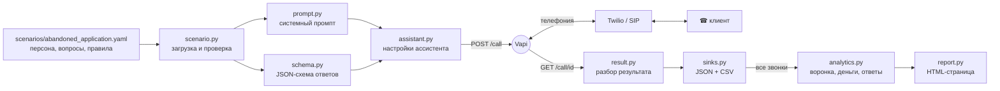

# Голосовой бот для обзвона

**Демо:** https://sharipovrus.github.io/voicebot/ — поговорить с ботом в браузере (RU / EN),
посмотреть, что он собирает, и аналитику звонков.

Бот звонит на заданный номер, представляется голосовым ассистентом, задаёт вопросы
из сценария и сохраняет ответы в JSON и CSV вместе с транскриптом и записью разговора.

Пример по умолчанию — брошенная заявка в банке. Клиент начал оформлять карту в приложении
и не закончил. Бот звонит от имени банка, узнаёт, что помешало, интересно ли ещё, можно ли
прислать SMS со ссылкой, чтобы продолжить с того же места, и нужен ли специалист.
Банк вымышленный. Сценариев два: `scenarios/abandoned_application.yaml` (русский,
«Не подозрительный банк») и `scenarios/abandoned_application_en.yaml` (английский,
Not Shady Bank). Код у них общий.

Звонить можно на любой номер в мире, если у оператора разрешена эта страна. После
звонков `python -m voicebot report` собирает аналитику по всем разговорам: воронку,
итоги, цену успешного звонка и распределение ответов.

```
$ python -m voicebot call +77011234567   # пример вывода, номер условный
Звонок создан: c0ffee00-... → +77011234567
  статус: queued
  статус: ringing
  статус: in-progress
  статус: ended

Звонок завершён: assistant-ended-call, длительность 1:12, $0.09
Итог: completed — Клиент бросил заявку на карту из-за ошибки при загрузке фото паспорта. Интерес остался, согласился получить SMS со ссылкой.
  drop_reason        техническая ошибка
  drop_reason_details Не загружалось фото паспорта, приложение зависало.
  still_interested   да
  link_consent       да
  specialist_time    —
  callback_time      —
  comment            —
Запись: https://storage.vapi.ai/...

Сохранено: results/calls/c0ffee00-....json, results/abandoned_application.csv
```

## Как устроено

Главная идея: **поведение бота полностью описано в одном YAML-файле**, код только
переводит его в настройки голосовой платформы и разбирает результат. Поэтому почти
любое изменение — это правка сценария, а не кода.



### Что происходит за один звонок

1. **Сценарий → настройки.** `scenario.py` читает YAML и подставляет переменные
   (`{{bank}}`, `{{product}}`, `{{stopped_at}}`). `prompt.py` собирает из персоны, вопросов и правил
   системный промпт. `schema.py` превращает вопросы в JSON-схему: каждый вопрос
   становится полем результата, плюс служебные поля (`outcome`, `summary`,
   `callback_time`, `comment`).
2. **Запуск звонка.** `assistant.py` собирает настройки ассистента Vapi: промпт,
   первую фразу, голос, распознавание речи, LLM, инструменты и схему ответов.
   `vapi.py` отправляет их вместе с номером в `POST /call`. Ассистент создаётся
   на один звонок (transient assistant), в дашборде Vapi ничего не хранится.
3. **Разговор.** Это делает Vapi: звонит через Twilio, распознаёт речь
   (Deepgram), отвечает с помощью LLM (GPT-4.1 mini) и озвучивает ответ (Azure TTS).
   У LLM есть два инструмента: `endCall` (положить трубку) и `dtmf` (нажать кнопки
   в голосовом меню).
4. **Извлечение ответов.** После того как трубку положили, Vapi прогоняет транскрипт
   через LLM и заполняет поля по нашей схеме (structured outputs).
5. **Результат.** `vapi.py` раз в 5 секунд опрашивает звонок, пока он не закончится
   и не появятся ответы. `result.py` раскладывает их в `CallResult` и отмечает
   обязательные вопросы без ответа. `sinks.py` сохраняет полный JSON и строку в CSV.
6. **Аналитика.** `python -m voicebot report` собирает все JSON сценария: `analytics.py`
   считает метрики, `report.py` рисует из них HTML-страницу (см. «Аналитика» ниже).

### Почему так

| Решение | Почему |
|---|---|
| Vapi вместо своей голосовой части | Телефония, распознавание речи, перебивания и задержки — это недели работы. Платформа даёт это из коробки, а логика остаётся у нас. |
| Сценарий в YAML | Вопросы, правила и голос меняются без кода. Сценарий лежит в git, изменения видны в диффе. |
| Ассистент создаётся на каждый звонок | Нет расхождения между кодом и дашбордом: что в репозитории, то и звонит. |
| Ответы извлекаются после звонка по схеме | Разговор остаётся естественным, а на выходе всегда одинаковая структура. Транскрипт и запись сохраняются для проверки. |
| Опрос статуса, а не webhook | Не нужен публичный сервер. Для потока звонков стоит перейти на webhook (см. ниже). |
| Запреты — в правилах сценария | Бот не спрашивает номер карты, коды из SMS, пароли и паспорт, ничего не обещает про одобрение и тарифы. Это видно и проверяется в одном файле, а для банка комплаенс спросит об этом первым. |
| Бот только спрашивает согласие на SMS | Ссылку отправляет система после звонка (приёмник в `sinks.py`), а не LLM во время разговора: так проще контролировать, кому и что ушло. |

## Быстрый старт

Сначала можно поговорить с ботом в браузере: нужен только ключ Vapi, телефония не нужна.

```bash
python -m venv .venv
.venv\Scripts\activate          # Windows; на macOS/Linux: source .venv/bin/activate
pip install -r requirements.txt
copy .env.example .env          # вписать VAPI_API_KEY
python -m voicebot check        # ключ работает?
python -m voicebot publish      # загрузить сценарий в Vapi (ассистент ищется по имени сценария)
```

В дашборде Vapi нажать **Talk to Assistant** и сыграть клиента, который бросил заявку. После разговора
id звонка есть в разделе Calls, результат забирается так: `python -m voicebot fetch <id>`.
После правок в YAML снова запустить `publish`, ассистент обновится.

Для звонков на телефон дальше нужен номер.

### 1. Номер, с которого звонить

Бесплатные номера Vapi принимают только входящие звонки, поэтому для исходящих нужен
свой номер. Код от выбора оператора не зависит: меняется только `VAPI_PHONE_NUMBER_ID`.
Почти вся цена минуты — это телефония (Vapi и модели — около $0,07–0,10 за минуту),
поэтому оператор выбирается по тому, куда звоним.

| Вариант | Когда | Цена минуты до мобильного в Казахстане |
|---|---|---|
| Звонок из браузера (`publish` → Talk to Assistant) | показать бота кому угодно, в любой стране | телефонии нет, только Vapi и модели |
| Twilio, пробный аккаунт | звонки на свой номер | бесплатно в пределах стартового баланса |
| Twilio, платный аккаунт | звонки на любые номера, быстро настроить | ~$0,50 |
| Свой SIP-транк (например, Zadarma) | много звонков, по всему миру, дешевле | ~$0,07–0,19, звонок с местного номера |

**Twilio:**
1. Зарегистрироваться в [Twilio](https://www.twilio.com). На пробном аккаунте можно звонить
   только на подтверждённые номера (Verified Caller IDs, подтверждение по SMS), перед
   разговором звучит фраза о пробном аккаунте и нужно нажать любую клавишу, звонок не дольше
   10 минут. Для теста на себе этого достаточно.
2. Купить номер (Phone Numbers → Buy a number).
3. Разрешить звонки в нужные страны: Voice → Settings → **Geo permissions** → Kazakhstan
   (и остальные).
4. Скопировать Account SID и Auth Token.

**SIP-транк:** подключается в Vapi как BYO SIP trunk. Бот звонит с местного номера, и трубку
берут охотнее, чем с незнакомого +1.

### 2. Vapi

1. Зарегистрироваться в [Vapi](https://dashboard.vapi.ai).
2. Phone Numbers → Create → **Import Twilio**: номер, Account SID, Auth Token.
   Скопировать id номера.
3. API Keys → скопировать Private key.

### 3. Настройка

Вписать в `.env` id номера (`VAPI_PHONE_NUMBER_ID`) и проверить: `python -m voicebot check`.

### 4. Запуск

```bash
python -m voicebot preview                       # что скажет бот и какие поля соберёт
python -m voicebot call 87011234567 --dry-run    # запрос в Vapi без звонка (форматы: 8701…, +7 701…, 701…)
python -m voicebot call <номер>                  # позвонить
python -m voicebot call <номер> --var product="кредитную карту" --var stopped_at="на шаге выбора тарифа"
python -m voicebot call +49<номер> --scenario scenarios/abandoned_application_en.yaml   # другая страна — с кодом
python -m voicebot fetch <call_id>               # забрать результат прошедшего звонка
python -m voicebot report                        # аналитика по всем звонкам + HTML-страница
python -m pytest                                 # тесты (без звонков и ключей)
```

Первый звонок лучше сделать на свой телефон и сыграть клиента: назвать причину, отказаться,
попросить перезвонить, попробовать продиктовать номер карты.

## Аналитика

`python -m voicebot report` читает все звонки сценария из `results/calls/*.json`, печатает
сводку и сохраняет страницу `results/<сценарий>_report.html`.

| Метрика | Как считается |
|---|---|
| Воронка | набрали номер → взяли трубку → поговорили с человеком → собрали все ответы (`outcome = completed`) |
| Взяли трубку | все звонки, кроме «не ответили», «занято» и ошибок соединения |
| Поговорили с человеком | взяли трубку, не автоответчик и не голосовое меню (`outcome ≠ no_human`) |
| Цена успешного звонка | все траты, включая неудачные звонки, ÷ число полных анкет. Главная цифра юнит-экономики |
| Цена минуты | все траты ÷ минуты звонков, где взяли трубку |
| Ответ на вопрос | в скольких разговорах с человеком есть ответ. Для чисел — мин / медиана / макс, для да/нет и вариантов — распределение |
| Кому перезвонить | звонки с `outcome = callback_requested` и время, которое назвали |

На странице номера телефонов скрыты (`+7701•••••67`), записей и транскриптов нет, поэтому её
можно публиковать. Полные данные остаются только локально в `results/`.

## Демо-страница

`docs/` — сайт на GitHub Pages: разговор с ботом в браузере на русском или английском,
список вопросов, схема устройства, аналитика по каждому сценарию.

```bash
python -m voicebot site      # обновить ассистентов в Vapi, docs/config.js и docs/analytics/*
git add docs && git commit -m "site: update" && git push
```

`site` проходит по всем `scenarios/*.yaml`: обновляет ассистента в Vapi (с ним говорит
страница), пересобирает аналитику и пишет в `docs/config.js` публичный ключ, id ассистентов
и вопросы. Страница грузит голосовой SDK Vapi (`@vapi-ai/web`, версия зафиксирована) с CDN.

Чтобы кнопка разговора заработала, нужен публичный ключ Vapi (`VAPI_PUBLIC_KEY` в `.env`).
Он виден в коде страницы, это нормально для публичного ключа, но в Vapi → API Keys его надо
ограничить: Allowed Origins — адрес сайта, Allowed Assistants — ассистенты сценариев.
Каждый разговор на странице оплачивается с аккаунта Vapi (около $0,07–0,10 за минуту,
не дольше `max_duration_seconds`).

## Структура

```
scenarios/
  abandoned_application.yaml     сценарий: что бот говорит, спрашивает и собирает
  abandoned_application_en.yaml  тот же сценарий на английском
voicebot/
  scenario.py                загрузка YAML, проверка, подстановка переменных
  texts.py                   служебные фразы промпта и схемы на ru / en
  prompt.py                  сценарий → системный промпт
  schema.py                  сценарий → JSON-схема ответов (+ служебные поля)
  assistant.py               всё вместе → настройки ассистента Vapi
  vapi.py                    HTTP-клиент: создать звонок, дождаться результата
  result.py                  звонок Vapi → CallResult
  sinks.py                   куда сохранять результат (JSON, CSV)
  analytics.py               все звонки → метрики: воронка, итоги, деньги, ответы
  report.py                  метрики → HTML-страница
  cli.py                     командная строка
tests/                       тесты на записанном примере звонка и на аналитике
docs/                        демо-страница для GitHub Pages (собирается командой site)
results/                     результаты звонков (не в git)
```

## Как вносить изменения

| Что нужно | Где менять |
|---|---|
| Добавить, убрать или переформулировать вопрос | `questions` в YAML. Поле в результате и столбец в CSV появятся сами. |
| Задавать вопрос только при условии | `ask_if` у вопроса: `ask_if: клиенту ещё интересно` |
| Ответ из фиксированных вариантов | `type: enum` и `options: [техническая ошибка, не устроили условия, другое]` |
| Без ответа не заканчивать разговор | `required: true` |
| Подсказать боту, как уточнять | `note` у вопроса |
| Другой продукт, банк, шаг, на котором бросили | `variables` в YAML или `--var` при запуске |
| Манера разговора, нестандартные ситуации, запреты | `rules` в YAML. Правило с «: » внутри — в кавычках |
| Подсказка для демо-страницы | `demo_hint` в YAML |
| Голос, распознавание речи, LLM | `vapi.voice`, `vapi.transcriber`, `vapi.model` |
| Другой язык | `language` в YAML, тексты сценария на этом языке, голос и `transcriber.language`. Служебные фразы — в `texts.py` (есть ru, en) |
| Любая другая настройка Vapi | `vapi.overrides`, попадает в ассистента как есть |
| Бот начинает говорить раньше, чем сказали «алло» | `vapi.overrides.firstMessageMode: assistant-waits-for-user` |
| Совсем другой сценарий (опрос после поддержки, напоминание о платеже) | скопировать YAML и запускать с `--scenario` |
| Поле, общее для всех сценариев | `standard_fields` в `schema.py`, описание поля — в `texts.py` |
| Отправить SMS со ссылкой тем, кто согласился | новая функция в `sinks.py`, добавить в `SINKS` (пример ниже) |
| Отправлять результат в CRM, Sheets, Slack | так же: функция в `sinks.py` |
| Перезванивать, если не взяли трубку | цикл в `cmd_call` в `cli.py` по `endedReason` |
| Получать результат сразу, без опроса | webhook: `server.url` в ассистенте, событие `end-of-call-report` |
| Новая метрика в аналитике | посчитать в `build_report` (`analytics.py`), показать на странице в `report.py` |

Пример: SMS со ссылкой тем, кто согласился (`sinks.py`, через Twilio):

```python
def send_link_sms(result: CallResult) -> None:
    if result.answers.get("link_consent") is not True:
        return
    sid = os.environ["TWILIO_ACCOUNT_SID"]
    requests.post(
        f"https://api.twilio.com/2010-04-01/Accounts/{sid}/Messages.json",
        auth=(sid, os.environ["TWILIO_AUTH_TOKEN"]),
        data={"From": os.environ["SMS_FROM"], "To": result.phone,
              "Body": f"Продолжите оформление: {os.environ['CONTINUE_URL']}"},
        timeout=10,
    )

SINKS = [save_json, append_csv, send_link_sms]
```

Пример: перезвон, если не ответили (`cli.py`, `cmd_call`):

```python
NO_ANSWER = {"customer-did-not-answer", "customer-busy"}

for attempt in range(1, 4):
    call = client.create_call(assistant, phone_number_id, phone)
    call = client.wait_for_result(call["id"])
    if call.get("endedReason") not in NO_ANSWER:
        break
    print(f"Не ответили (попытка {attempt}), перезвоню через 5 минут")
    time.sleep(300)
```

## Ограничения

- Ответы извлекает LLM, она может ошибиться. Поэтому рядом всегда лежат транскрипт и запись.
- `missing_required` не учитывает `ask_if`: если клиенту неинтересно, согласие на SMS попадёт в «без ответа».
  По той же причине в аналитике доля ответов на вопрос с условием считается от всех разговоров.
- Номер Twilio обычно американский, на незнакомый +1 в Казахстане отвечают реже.
  Для реального обзвона лучше местный номер через SIP.
- Звонки идут по одному. Для обзвона списка нужна очередь и webhook вместо опроса.
- Перед реальным обзвоном нужно согласие клиентов на звонки и проверка требований закона
  к автоматическим звонкам и персональным данным (GDPR в ЕС, закон о персональных данных в РК).
  Бот в первой же фразе говорит, что он голосовой ассистент.
